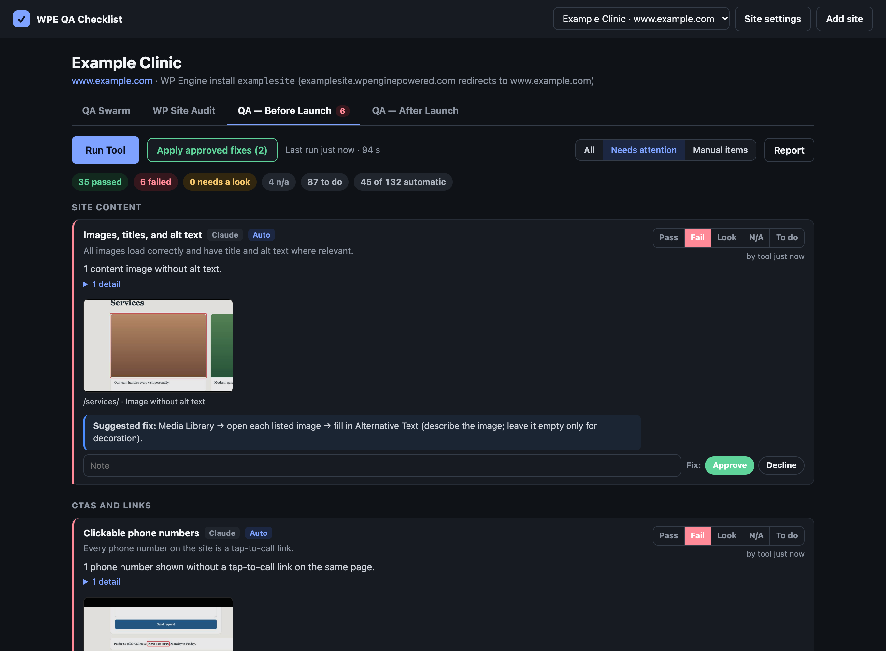
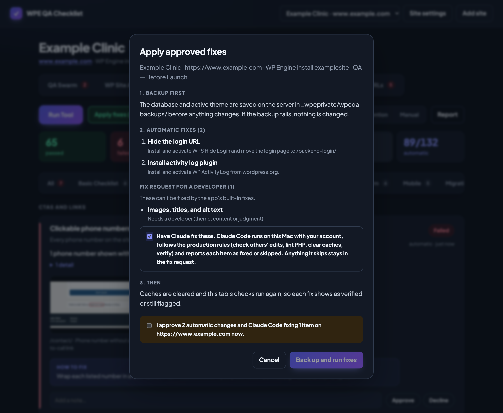
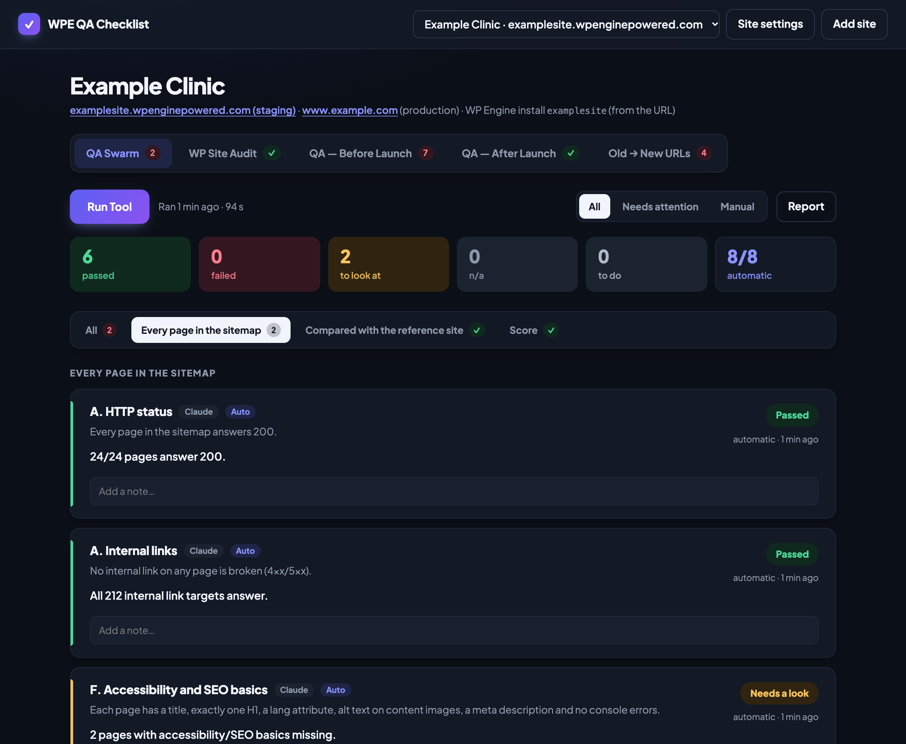

# WPE QA Checklist

A local web app for QA on **WP Engine** WordPress sites. One tab per checklist, each with a
**Run Tool** button that runs the automatic checks and fills the checklist in:

| Tab | What Run Tool does |
|---|---|
| **QA Swarm** | Crawls every sitemap page on desktop and phone: HTTP status, internal links, accessibility/SEO basics, 375 px fit, phone menu, screenshots, and (with a reference site) content completeness. Scores each page and the whole site, like the `qa-swarm` skill. |
| **WP Site Audit** | The `wp-site-audit` skill's checks: collapsed and empty links, asset URLs used as links, duplicate images, junk posts and slug collisions, exposed emails, mu-plugins, long H1s, alt text, phone formats, CPT featured images, Yoast title suffix, placeholder leaks, page-local styles. |
| **QA — Before Launch** | The Audit Sheet's "QA — Before Launch" tab. 45 of 132 items are checked automatically (WordPress settings, plugins, updates, login URL, 404, alt text, tap-to-call phones, headings, tap targets, consent, security headers, schema, Lighthouse…). The rest are manual. |
| **QA — After Launch** | The Audit Sheet's "QA — After Launch" tab. 24 of 48 items are automatic (indexable, old/staging URLs in the database, SSL and mixed content, sitemap, robots.txt, noindex, staging links, consent, schema drift, console errors, Lighthouse…). |
| **Old → New URLs** | Tests every page of the old site on the new site and proposes the redirects; approved ones are added to the Redirection plugin for you (see below). |

Every failed or flagged item also shows a **Suggested fix** (plain WordPress steps; tagged **App can
fix** when the app has an automatic fix for it) and, where the problem is on the page, **screenshots**:
Chrome opens the page and frames the problem in red (the image without alt text, the phone number
that isn't a link, the H1, the form without anti-spam, the footer missing a link…), up to 3 per item.
Click a thumbnail to see it large over the app (arrow keys step through an item's screenshots; Esc closes). Settings and header checks (indexing, robots.txt, GA tags) get the
suggestion only, since there is nothing on the page to point at.

Automatic items show the status Run Tool found (read-only; a wrong finding is handled with
**Decline**). Manual items, the ones no tool can check, have **Pass / Fail / Look / N/A / To do** buttons.
Every item has a note. Items that fail or need a look
get **Fix: Approve / Decline**, and **Apply approved fixes** carries out the approved ones with a backup
first (see below). **Report** opens a
Markdown summary of the tab for pasting into the sheet, a ticket or a message.

Elementor and YOOtheme sections are kept but marked N/A automatically unless the site uses them.









Screenshots use a made-up demo site (example.com).

## Old → New URLs

For a redesign or a move to a new site. Set the **Old site URL** in Site settings, open the
**Old → New URLs** tab and press **Run Tool** (read-only). It lists every page of the old site (from its
sitemap, or by following its links) and opens each old address on the new site:

| Status | Meaning |
|---|---|
| **No redirect needed** | The same address works on the new site, or already lands on the right page |
| **Redirect** | The old address is a 404 on the new site; the matching new page was found by its slug or title (e.g. `/car-accident-chiropractor` → `/services/car-accident-chiropractor/`, `/new-page-1` → `/conditions/mid-back-pain/`) |
| **Needs attention** | A person should decide: no match, two new pages match equally, several old pages would land on the same new page, or WordPress guessed a different page (e.g. `/test/` → `/testimonials/`). Pick or type the new URL (the box suggests the new site's pages) |

The scan sets every status; you can't change it. Rows that need attention take a new URL from you; then
**Approve** the redirects you want. Pages that exist only on the new site are listed under
**New on the new site** for review (nothing to redirect). **Add redirects (N)** opens
a confirmation listing each one; after you confirm, the app backs up the site, installs and activates
the [Redirection](https://wordpress.org/plugins/redirection/) plugin if it isn't there, adds every
approved row as a 301 through the plugin's own API (into its "Redirections" group; addresses that
already have a redirect are left alone), clears caches and opens each old address to check it now
redirects. Nobody types redirects into the plugin by hand.

From the command line: `node bin/wpeqa.mjs urls <site> run | approve <ids> | plan | apply --yes`.

## Fixing approved items

1. **Run Tool** finds the issues (read-only).
2. Tick **Approve** (or Decline) on failed and flagged items. Add a note where a fix needs a value,
   e.g. the new login slug for "Hide the login URL" or the new name for "Uncategorized".
3. **Apply approved fixes (N)** opens a confirmation window that lists, before anything happens:
   the backup, every automatic fix with exactly what it will do, and the items that will go to a
   fix request. Nothing runs until you tick the confirmation and press the button.
4. The fix run then:
   - **backs up first** to `_wpeprivate/wpeqa-backups/<run>/` on the server: the database
     (`db.sql.gz`), the active theme (`theme.tgz`), the plugins folder when plugin updates are
     approved, the plugin list and the WordPress version. If the backup fails, nothing is changed.
   - applies the **automatic fixes** over SSH/WP-CLI, logging each command's output;
   - clears caches (WordPress, WP Engine, WP Rocket if present);
   - **re-runs the tab's checks**, so each fix is marked **Fixed · verified** or **Fix applied ·
     still flagged** (or **Fix failed**);
   - writes a **fix request** for approved items the app can't fix safely (theme code, content,
     judgment calls). Copy it from **Fix history and backups** and hand it to Claude or a developer.
5. **Fix history and backups** lists every fix run with its backup path and **Copy restore
   commands** (database import + theme/plugins restore).

Automatic fixes (everything else goes to the fix request): turn comments off · search engine
visibility on/off · rename "Uncategorized" · trash Hello World / Sample Page · permalinks to post
name · install WP Activity Log · install WPS Hide Login with the slug from the note · update plugins ·
update WordPress core · set the admin email · replace the staging domain in the database
(`wp search-replace`, dry run first, GUIDs untouched). They live in `lib/fixers.mjs`.

Plain **Run Tool** runs never change the site, so they don't take a backup.

## Run it from Claude Code

Clone the repo, run `npm install`, open Claude Code in the folder (accept the trust prompt the
first time, so the pre-approved commands apply) and ask, for example:

```
/qa https://www.example.com
```

Claude reads `CLAUDE.md`, installs what's missing, adds the site, runs all four checklists and
summarises what needs fixing. Tell it which items to fix (or tick them in the web app), then:

```
/fix example-com before-launch
```

Claude shows the plan, waits for your yes, runs the backed-up fix, then fixes the remaining
fix-request items itself under the same production rules and verifies them. Read-only commands
are pre-approved in `.claude/settings.json`; the `fix` command is not, so Claude Code also asks
before running it.

Everything the buttons do is also on the command line: `node bin/wpeqa.mjs help`.

In the web app, the confirmation window has **Have Claude fix these** for items the app can't
fix by itself: after the backup and automatic fixes it starts a headless Claude Code run on this
Mac (your account) with the fix request and the production rules, streams its progress into the
log, and marks each item fixed (then verified by a re-check) or skipped.

## Requirements

- macOS with **Google Chrome** installed (or set `CHROME_PATH`).
- **Node 20+**.
- Your SSH key added to WP Engine (User Portal → Profile → SSH keys), so
  `ssh <install>@<install>.ssh.wpengine.net` works without a password.
- For re-importing checklists: Python 3 with `openpyxl`.
- For Claude features: Claude Code (`claude`) installed and signed in (`claude auth status`;
  sign in with `claude auth login`). The app checks this before offering "Have Claude fix these".

## Run it

```
npm install
npm start
```

Open http://localhost:4646, click **Add site**, and enter the WP Engine install name (the part
before `.wpenginepowered.com`). The app only listens on this Mac (127.0.0.1).

## What Run Tool touches

Run Tool is **read-only** (fix runs are separate, below):

- Over SSH it runs one `wp eval-file` that reads settings, plugins, users, posts and options and
  prints them as JSON. It changes nothing. (It does ask WordPress to refresh its plugin/core
  update check, the same thing WP-Admin does on its own.)
- Pages come from the XML sitemap. Before launch, when "Discourage search engines" turns WordPress's
  sitemaps off, the app follows the site's own links (menus, footer, page content) two levels deep.
- In Chrome it loads the site's pages like a visitor: no logins, no form submissions, no clicks
  except opening the phone menu. It scrolls through each page before checking it, so lazy-loaded
  images and scripts that speed plugins hold back until the first scroll are checked too. The cookie
  consent check also scrolls and moves the mouse (never clicking the banner), because holding
  trackers back until the first scroll is not consent.
- Lighthouse runs against the homepage from this Mac.

Results, screenshots, Lighthouse reports and your checklist ticks are saved under `data/`
(git-ignored). Run Tool sets the status of every automatic item each time it runs; statuses you set on manual
items are kept.

## Your agency's details

Checklist text refers to agency details as placeholders (`{{adminEmail}}`, `{{teamEmail}}`,
`{{callTrackingProvider}}`, …) and owners are roles (Account Manager, Domain & DNS, …), so the repo
stays generic. Fill in yours once:

```
cp config/agency.example.json config/agency.json
```

`config/agency.json` is git-ignored. Its values are shown everywhere in the app, reports and Claude
prompts, and `people` puts names next to roles (e.g. "Account Manager (Alex)"). The admin email is
also the default "expected admin email" for new sites.

## Updating the checklists from the Audit Sheet

```
npm run import-sheet -- "/path/to/Audit Sheet.xlsx"
```

This rewrites `checklists/before-launch.json` and `checklists/after-launch.json` from the
"QA — Before Launch" and "QA — After Launch" tabs, turning your `config/agency.json` values back
into placeholders and people's names into their roles, so nothing agency-specific is committed. Which rows are automatic is set by the `AUTO`
map in `scripts/import-sheet.py`; a renamed row there stops the import with an error rather than
silently losing its check. Saved ticks are keyed by section + title, so renaming a row starts it
fresh.

## Adding a check

1. Write the function in `lib/checks.mjs` (`CHECKS`, `SWARM` or `AUDIT`). It gets `ctx` with
   `ctx.facts()` (WordPress data), `ctx.pages()` (desktop snapshot of every page),
   `ctx.mobilePages()`, `ctx.homeSnap()`, `ctx.linkCheck()`, `ctx.lighthouse()` and `ctx.home`, and
   returns `{ status: 'pass' | 'fail' | 'warn' | 'na', summary, details }`.
2. Point the item at it: the `AUTO` map in `scripts/import-sheet.py` for sheet rows, or the
   `check` field in `checklists/qa-swarm.json` / `wp-site-audit.json`.

## Layout

```
server.mjs              local web server and run queue (SSE progress)
lib/wpe.mjs             SSH + WP-CLI facts (read-only)
lib/crawl.mjs           sitemap discovery and Chrome page snapshots
lib/checks.mjs          every automatic check
lib/suggest.mjs         suggested fix per check
lib/evidence.mjs        screenshots of where each flagged problem is
lib/run.mjs             runs a tab: loads data once, runs its checks, writes results
lib/fixers.mjs          automatic fixes for approved items + fix request text
lib/fixrun.mjs          fix run: backup, fixes, cache clear
lib/lighthouse.mjs      Lighthouse phone + desktop
lib/store.mjs           sites, checklist state, run history (data/)
lib/report.mjs          Markdown report
checklists/*.json       the four checklists
scripts/import-sheet.py Audit Sheet → checklists
public/                 the app (no build step)
```
