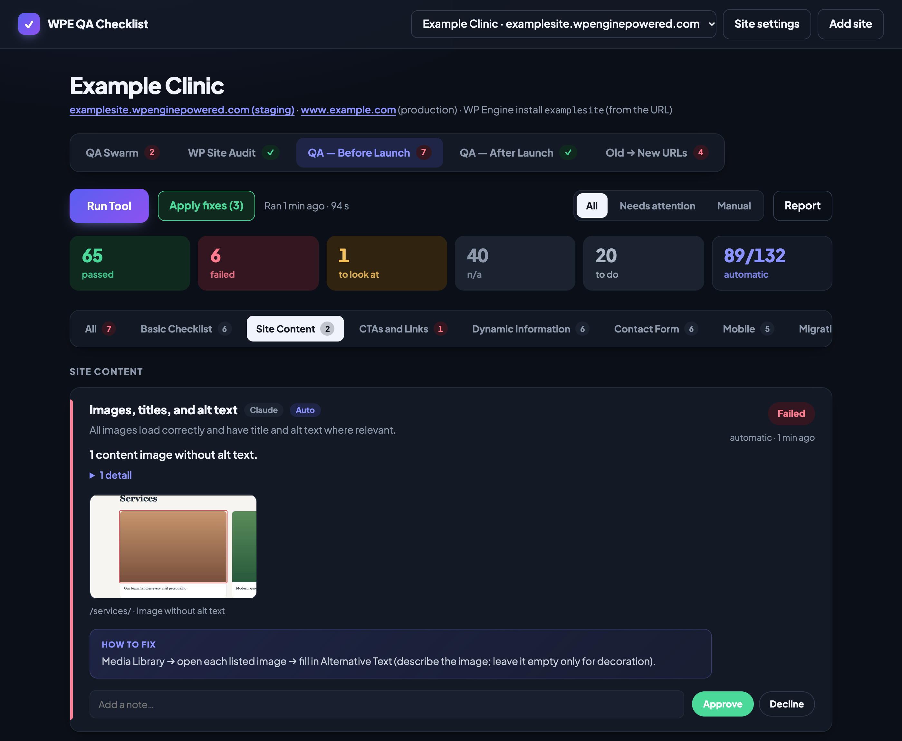
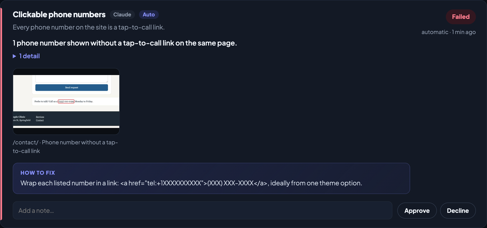
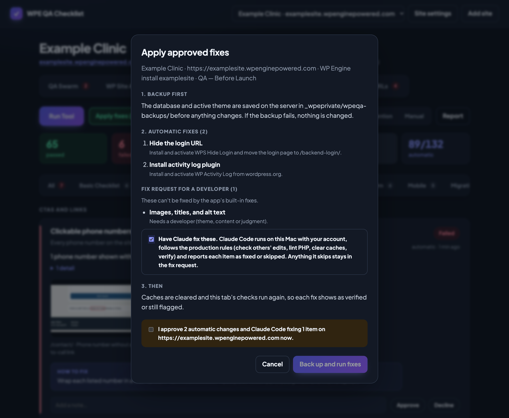
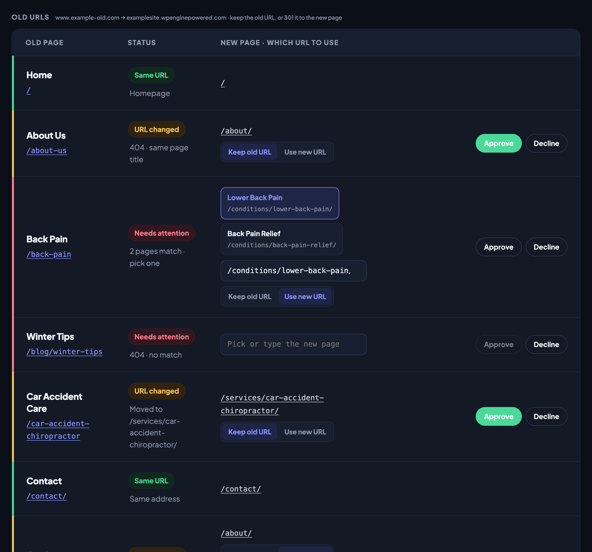
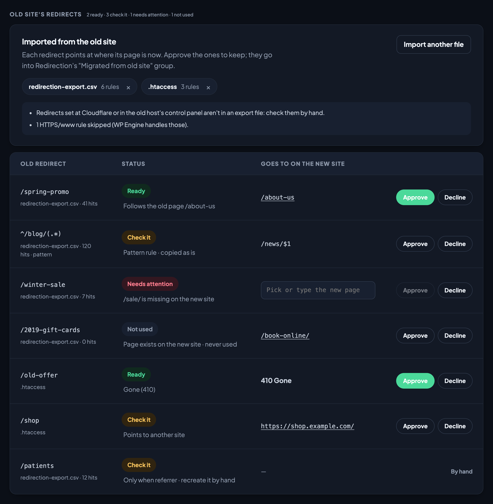

# WPE QA Checklist

A local web app for QA on **WP Engine** WordPress sites. One tab per checklist, each with a
**Run Tool** button that runs the automatic checks and fills the checklist in.

**Version 0.2.0** (shown next to the app's name in the header; see [CHANGELOG.md](CHANGELOG.md)).

**New in 0.2.0: security checks.** On sites running [Greenlight](https://github.com/yoborj/greenlight) **v0.2.0 or
newer**, Run Tool reads Greenlight's security setup and alerts:

- **Before launch:** are the recommended hardening features on (security headers, hidden usernames, file editor
  off, email obfuscation, admin-change, script-drift, core-file and content alerts)? The app can turn the missing
  ones on for you, with a backup first.
- **After launch:** are there open security alerts on the live site (admin changes, new script domains, changed
  core files, suspicious content)? High-severity alerts fail the checklist.
- The report, the command line (`wpeqa greenlight <site>`) and the security-headers and exposed-email
  suggestions all show it. Details: [Greenlight security](#greenlight-security).

| Tab | What Run Tool does |
|---|---|
| **QA Swarm** | Crawls every sitemap page on desktop and phone: HTTP status, internal links, accessibility/SEO basics, 375 px fit, phone menu, screenshots, and (with a reference site) content completeness. Scores each page and the whole site, like the `qa-swarm` skill. |
| **WP Site Audit** | The `wp-site-audit` skill's checks: collapsed and empty links, asset URLs used as links, duplicate images, junk posts and slug collisions, exposed emails, mu-plugins, long H1s, alt text, phone formats, CPT featured images, Yoast title suffix, placeholder leaks, page-local styles. |
| **QA — Before Launch** | The Audit Sheet's "QA — Before Launch" tab. 90 of 133 items are checked automatically (WordPress settings, plugins, updates, login URL, Greenlight security hardening, 404, alt text, tap-to-call phones, headings, tap targets, consent, security headers, schema, Lighthouse…). The rest are manual. |
| **QA — After Launch** | The Audit Sheet's "QA — After Launch" tab. 35 of 49 items are automatic (indexable, old/staging URLs in the database, SSL and mixed content, open Greenlight security alerts, sitemap, robots.txt, noindex, staging links, consent, schema drift, console errors, Lighthouse…). |
| **Old → New URLs** | Tests every page of the old site on the new site and proposes the redirects, and carries over the old site's own redirects from its export file; approved ones are added to the Redirection plugin for you (see below). |

Every failed or flagged item also shows a **Suggested fix** (plain WordPress steps; tagged **App can
fix** when the app has an automatic fix for it) and, where the problem is on the page, **screenshots**:
Chrome opens the page and frames the problem in red (the image without alt text, the phone number
that isn't a link, the H1, the form without anti-spam, the footer missing a link…), up to 3 per item.
Click a thumbnail to see it large over the app (arrow keys step through an item's screenshots; Esc closes). Settings and header checks (indexing, robots.txt, GA tags) get the
suggestion only, since there is nothing on the page to point at.

Automatic items show the status Run Tool found (read-only; a wrong finding is handled with
**Decline**). Manual items, the ones no tool can check, have **Pass / Fail / Look / N/A / To do** buttons.
Every item has a note. Items that fail or need a look
get **Fix: Approve / Decline**, and **Apply approved fixes** carries out the approved ones with a backup
first (see below). **Report** opens a
Markdown summary of the tab for pasting into the sheet, a ticket or a message.

Elementor, YOOtheme and Tailwind sections are kept but marked N/A automatically unless the site uses them.

**Staging and production.** Each site has a **Staging site to audit** (QA Swarm, WP Site Audit, Before Launch
and Old → New URLs all run there) and a **Production site to audit** (the live domain). **QA — After Launch**
checks production only, so it stays locked until someone confirms the new site is live there: the app checks
the production address isn't a staging address, answers, and is served by the new WordPress (its home URL is
that domain), then asks for the confirmation. Changing the production address locks it again.
From the command line: `node bin/wpeqa.mjs confirm-live <site> --yes`.









Screenshots use a made-up demo site (example.com).

## Old → New URLs

For a redesign or a move to a new site, the goal is to keep the old site's URLs. Set the **Old site URL**
in Site settings, open the **Old → New URLs** tab and press **Run Tool** (read-only). It lists every page
of the old site (from its sitemap, or by following its links) and opens each old URL on the new site:

| Status | Meaning |
|---|---|
| **Same URL** | The old URL works on the new site as it is |
| **URL changed** | The page moved (e.g. `/car-accident-chiropractor` → `/services/car-accident-chiropractor/`); the matching new page was found by its slug or title |
| **Needs attention** | A person picks the new page (see below) |

**Needs attention** rows are the ones the scan can't settle on its own:

- **Two new pages match equally**: both are shown with their title and address; one click picks one.
- **No match**, **several old pages would land on the same new page**, or **WordPress guessed a different
  page** (e.g. `/test/` → `/testimonials/`): pick or type the new page; the box suggests the new site's pages.

Picking a page checks again (read-only, over SSH) whether that page can keep the old URL. These rows start on
**Use new URL**; while **Keep old URL** is chosen, the page picker is locked and grayed out, so switch back to
Use new URL to pick a different page.

The scan sets every status. For each changed URL **you choose which URL to use**:

- **Keep old URL**: the app moves the new page back to the old address (its slug, and its parent page for
  nested addresses) and adds a 301 from where it was, so links to the new URL keep working. Pre-selected on
  URL changed rows whenever WordPress can serve the old address; the scan checks that over SSH and explains when it can't
  (a `.html` address or query string, no parent page at that path, another page already there, a post type
  with a fixed prefix).
- **Use new URL**: a 301 from the old URL to the new page.

Then **Approve** the rows. **Apply URL decisions (N)** opens a confirmation listing each change; after you
confirm, the app backs up the site, installs and activates the [Redirection](https://wordpress.org/plugins/redirection/)
plugin if it isn't there, moves the kept pages, adds every 301 through the plugin's own API (addresses that
already have a redirect are left alone), clears caches and opens each old URL to check it: kept ones must
show their page, redirected ones must 301. Pages that exist only on the new site are listed under
**New on the new site** for review.

From the command line: `node bin/wpeqa.mjs urls <site> run | choose <id> keep|new | approve <ids> | plan | apply --yes`.



### The old site's own redirects

Redirects the old site already has (old campaigns, earlier redesigns) aren't pages, so the scan can't see them,
and without them they'd 404 after launch. **Old site's redirects**, at the top of the tab, takes the old site's
export: press **Import export file** or drop the file on the card. It reads:

- the Redirection plugin's export (JSON or CSV), a Yoast Premium or Rank Math CSV, or any CSV with source and
  target columns;
- the old `.htaccess` (`Redirect`, `RedirectMatch`, and `RewriteRule` with `R` or `G`; WordPress's own rules and
  HTTPS/www rules are skipped) or nginx `rewrite … permanent;` rules.

Import more than one file if the redirects live in several places. Importing is read-only. Each redirect is
pointed at where its page is now, using your page decisions:

| Status | Meaning |
|---|---|
| **Ready** | Its target exists on the new site, or is an old page from the page list (it follows that page's Keep / Use new choice, so a chain like old → old → new becomes one hop), or it's a 410 |
| **Check it** | A pattern rule, a link to another site, or a temporary (302) redirect |
| **Needs attention** | Its target is missing on the new site (pick or type one), its address is now a real page that it would hide, or two files disagree about it |
| **Not used** | Never used, or not in a year (from Redirection's hit counts): consider Decline |

Redirects with conditions (referrer, login, …) are marked **By hand**. Approved ones are applied with the page
decisions by **Apply URL decisions**, into the Redirection plugin's **Migrated from old site** group, and each
one is opened to check it: one hop to its target, or 410. Rules set at Cloudflare or the old host's control
panel aren't in any export file, so check those by hand. From the command line:
`urls <site> import <file> | forget <file-name> | approve --all-ready`.



## Greenlight security

Sites that run [Greenlight](https://github.com/yoborj/greenlight) v0.2.0+ report their security setup through
`wp greenlight security --format=json`. Run Tool reads it over SSH (one short call per run, on the install that tab
checks: staging for Before Launch, production for After Launch):

| Tab | Item | Result |
|---|---|---|
| **QA — Before Launch** → Security and Updates | **Greenlight security hardening** | Fails while any recommended feature is off: security headers, hide usernames, file editor off, email obfuscation, admin-change alerts, script-drift alerts, core-file check, content check. HSTS and CSP (report-only) are listed for information only. **App can fix**: approve it and the fix run turns the off features on with `wp greenlight set <feature> 1` (one short command each, after the usual backup), then re-checks. |
| **QA — After Launch** → Security and Updates | **No open Greenlight security alerts** | Open alerts grouped by severity, high first. Any **high** alert fails; medium and low need a look. |

What the app does with each Greenlight feature:

| Greenlight feature | What it does on the site | In the app |
|---|---|---|
| Security headers | Sends the standard security headers | Recommended · app can turn on |
| Hide usernames | Keeps login names from showing publicly | Recommended · app can turn on |
| File editor off | Removes the theme/plugin code editor from wp-admin | Recommended · app can turn on |
| Email obfuscation | Hides email addresses on pages from scrapers | Recommended · app can turn on |
| Admin-change alerts | Alerts when an administrator is added or changed | Recommended · app can turn on |
| Script-drift alerts | Alerts when pages load a script from a domain not in the baseline | Recommended · app can turn on |
| Core-file check | Alerts when WordPress core files change | Recommended · app can turn on |
| Content check | Alerts on suspicious content added to posts | Recommended · app can turn on |
| HSTS | Tells browsers to use HTTPS only | For information (turn on once every subdomain serves HTTPS) |
| CSP (report-only) | Content Security Policy in report-only mode (reports, blocks nothing) | For information |
| XML-RPC off | Turns off xmlrpc.php | Shown, optional |
| Application passwords off | Turns off WordPress application passwords | Shown, optional |

The CLI command also lists Greenlight's script baseline and trusted embed domains.

When Greenlight can't answer, the item says why instead: **not installed**, **installed but inactive**,
**update Greenlight to v0.2.0+** (older versions don't have the command), **unsupported schema** (a newer
Greenlight than this app reads; update the app), or output that isn't valid JSON. None of these stop the run.

The **HTTP Security Headers** (Before Launch) and **Exposed email addresses** (WP Site Audit) items name the
matching Greenlight feature in their suggested fix, and say whether it is on for that site.

The Markdown **Report** has a **Security:** line with the Greenlight version, how many recommended features are on and
the open alerts. From the command line, `node bin/wpeqa.mjs greenlight <site>` prints the full status for
staging and production (read-only), and `status` shows the same one-liner per tab.

The minimum Greenlight version is `GREENLIGHT_MIN_VERSION` in `lib/greenlight.mjs`. `npm test` checks the
parser, the items, the fix and the report against saved Greenlight output in `test/fixtures/greenlight/` (valid,
old Greenlight, not installed, inactive, bad JSON, schema 2); it never connects to a site. To try the app
against one of those files instead of SSH, start it with `WPEQA_GREENLIGHT_FIXTURE=test/fixtures/greenlight/valid.txt`.

## Fixing approved items

1. **Run Tool** finds the issues (read-only).
2. Tick **Approve** (or Decline) on failed and flagged items. Add a note where a fix needs a value,
   e.g. the new login slug for "Hide the login URL" or the new name for "Uncategorized".
3. **Apply approved fixes (N)** opens a confirmation window that lists, before anything happens:
   the backup, every automatic fix with exactly what it will do, and the items that will go to a
   fix request. Nothing runs until you tick the confirmation and press the button.
4. The fix run then:
   - **backs up first** to `_wpeprivate/wpeqa-backups/<run>/` on the server: the database
     (`db.sql.gz`), the active theme (`theme.tgz`), the plugins folder when plugin updates are
     approved, the plugin list and the WordPress version. If the backup fails, nothing is changed.
   - applies the **automatic fixes** over SSH/WP-CLI, logging each command's output;
   - clears caches (WordPress, WP Engine, WP Rocket if present);
   - **re-runs the tab's checks**, so each fix is marked **Fixed · verified** or **Fix applied ·
     still flagged** (or **Fix failed**);
   - writes a **fix request** for approved items the app can't fix safely (theme code, content,
     judgment calls). Copy it from **Fix history and backups** and hand it to Claude or a developer.
5. **Fix history and backups** lists every fix run with its backup path and **Copy restore
   commands** (database import + theme/plugins restore).

Automatic fixes (everything else goes to the fix request): turn comments off · search engine
visibility on/off · rename "Uncategorized" · trash Hello World / Sample Page · permalinks to post
name · install WP Activity Log · install WPS Hide Login with the slug from the note · update plugins ·
update WordPress core · set the admin email · replace the staging domain in the database
(`wp search-replace`, dry run first, GUIDs untouched) · turn on Greenlight's recommended security features. They live in `lib/fixers.mjs`.

Plain **Run Tool** runs never change the site, so they don't take a backup.

## Run it from Claude Code

Clone the repo, run `npm install`, open Claude Code in the folder (accept the trust prompt the
first time, so the pre-approved commands apply) and ask, for example:

```
/qa https://www.example.com
```

Claude reads `CLAUDE.md`, installs what's missing, adds the site, runs the checklists (QA — After Launch
only once production is confirmed live) and summarises what needs fixing. Tell it which items to fix (or tick them in the web app), then:

```
/fix example-com before-launch
```

Claude shows the plan, waits for your yes, runs the backed-up fix, then fixes the remaining
fix-request items itself under the same production rules and verifies them. Read-only commands
are pre-approved in `.claude/settings.json`; the `fix` command is not, so Claude Code also asks
before running it.

Everything the buttons do is also on the command line: `node bin/wpeqa.mjs help`.

In the web app, the confirmation window has **Have Claude fix these** for items the app can't
fix by itself: after the backup and automatic fixes it starts a headless Claude Code run on this
Mac (your account) with the fix request and the production rules, streams its progress into the
log, and marks each item fixed (then verified by a re-check) or skipped.

## Requirements

- macOS with **Google Chrome** installed (or set `CHROME_PATH`).
- **Node 20+**.
- Your SSH key added to WP Engine (User Portal → Profile → SSH keys), so
  `ssh <install>@<install>.ssh.wpengine.net` works without a password.
- For re-importing checklists: Python 3 with `openpyxl`.
- For Claude features: Claude Code (`claude`) installed and signed in (`claude auth status`;
  sign in with `claude auth login`). The app checks this before offering "Have Claude fix these".

## Run it

```
npm install
npm start
```

Open http://localhost:4646, click **Add site**, and enter the staging URL (and the production URL once
the site is live). The app only listens on this Mac (127.0.0.1).

After pulling changes, restart the app. If `npm start` says `EADDRINUSE` (port 4646 in use), the old copy is
still running: stop it first with `lsof -ti tcp:4646 | xargs kill`, then `npm start` again.

## What Run Tool touches

Run Tool is **read-only** (fix runs are separate, below):

- Over SSH it runs one `wp eval-file` that reads settings, plugins, users, posts and options and
  prints them as JSON. It changes nothing. (It does ask WordPress to refresh its plugin/core
  update check, the same thing WP-Admin does on its own.)
- Pages come from the XML sitemap. Before launch, when "Discourage search engines" turns WordPress's
  sitemaps off, the app follows the site's own links (menus, footer, page content) two levels deep.
- In Chrome it loads the site's pages like a visitor: no logins, no form submissions, no clicks
  except opening the phone menu. It scrolls through each page before checking it, so lazy-loaded
  images and scripts that speed plugins hold back until the first scroll are checked too. The cookie
  consent check also scrolls and moves the mouse (never clicking the banner), because holding
  trackers back until the first scroll is not consent.
- Lighthouse runs against the homepage from this Mac.

Results, screenshots, Lighthouse reports and your checklist ticks are saved under `data/`
(git-ignored). Run Tool sets the status of every automatic item each time it runs; statuses you set on manual
items are kept.

## Your agency's details

Checklist text refers to agency details as placeholders (`{{adminEmail}}`, `{{teamEmail}}`,
`{{callTrackingProvider}}`, …) and owners are roles (Account Manager, Domain & DNS, …), so the repo
stays generic. Fill in yours once:

```
cp config/agency.example.json config/agency.json
```

`config/agency.json` is git-ignored. Its values are shown everywhere in the app, reports and Claude
prompts, and `people` puts names next to roles (e.g. "Account Manager (Alex)"). The admin email is
also the default "expected admin email" for new sites.

## Updating the checklists from the Audit Sheet

```
npm run import-sheet -- "/path/to/Audit Sheet.xlsx"
```

This rewrites `checklists/before-launch.json` and `checklists/after-launch.json` from the
"QA — Before Launch" and "QA — After Launch" tabs, turning your `config/agency.json` values back
into placeholders and people's names into their roles, so nothing agency-specific is committed. Which rows are automatic is set by the `AUTO`
map in `scripts/import-sheet.py`; a renamed row there stops the import with an error rather than
silently losing its check. Items the app adds that aren't sheet rows (the Greenlight items) are in its `EXTRA` map
and are added back on every import. Saved ticks are keyed by section + title, so renaming a row starts it
fresh.

## Adding a check

1. Write the function in `lib/checks.mjs` (`CHECKS`, `SWARM` or `AUDIT`) or `lib/checks-more.mjs` (`MORE`). It gets `ctx` with
   `ctx.facts()` (WordPress data), `ctx.pages()` (desktop snapshot of every page),
   `ctx.mobilePages()`, `ctx.homeSnap()`, `ctx.linkCheck()`, `ctx.lighthouse()`, `ctx.greenlight()` (Greenlight's
   security status) and `ctx.home`, and
   returns `{ status: 'pass' | 'fail' | 'warn' | 'na', summary, details }`.
2. Point the item at it: the `AUTO` map in `scripts/import-sheet.py` for sheet rows, or the
   `check` field in `checklists/qa-swarm.json` / `wp-site-audit.json`.

## Layout

```
server.mjs              local web server and run queue (SSE progress)
lib/wpe.mjs             SSH + WP-CLI facts (read-only)
lib/crawl.mjs           sitemap discovery and Chrome page snapshots
lib/checks.mjs          automatic checks (core, QA Swarm, WP Site Audit, Tailwind)
lib/checks-more.mjs     more automatic checks (navigation, phone layout, forms, accessibility, migration, hosting, builders)
lib/checks-greenlight.mjs  Greenlight security hardening and alerts
lib/greenlight.mjs      reads `wp greenlight security` over SSH; version and schema checks (read-only)
lib/redirects.mjs       Old → New URLs: scan, keep-or-new choice, Redirection plugin apply
lib/legacy.mjs          the old site's own redirects: export-file import, mapping onto the new site
lib/live.mjs            QA — After Launch gate: production checks and the live confirmation
lib/suggest.mjs         suggested fix per check
lib/evidence.mjs        screenshots of where each flagged problem is
lib/run.mjs             runs a tab: loads data once, runs its checks, writes results
lib/fixers.mjs          automatic fixes for approved items + fix request text
lib/fixrun.mjs          fix run: backup, fixes, cache clear
lib/lighthouse.mjs      Lighthouse phone + desktop
lib/store.mjs           sites, checklist state, run history (data/)
lib/report.mjs          Markdown report
checklists/*.json       the four checklists
scripts/import-sheet.py Audit Sheet → checklists
test/                   `npm test`: Greenlight checks against saved output (no site needed)
public/                 the app (no build step)
```
